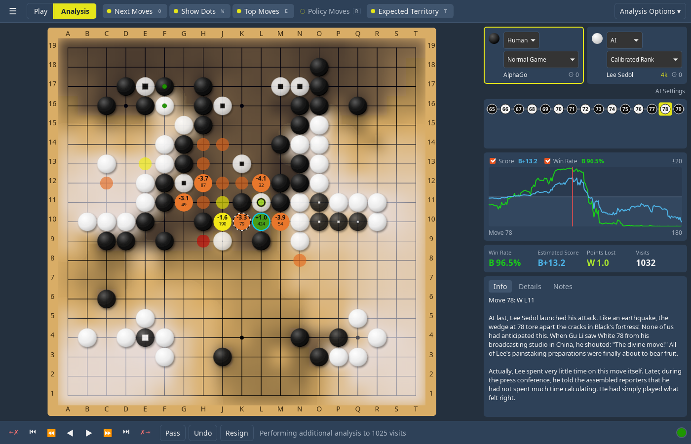

# Katraineo

**A modern, lightweight native desktop app for analyzing Go / Baduk / Weiqi games and training with KataGo.**

## Highlights

* **Fast, native desktop experience** — Built with [Tauri v2](https://v2.tauri.app/) (Rust), React, and TypeScript with crisp SVG board rendering, native file dialogs, OS file associations (`.sgf`, `.gib`, `.ngf`), single-instance file handoff, remembered window layout, and a *Recent Files* menu.
* **Ready out of the box — local, remote, or CPU** — Bundles KataGo (`Metal` on Apple Silicon, `OpenCL` on Windows/Linux/Intel) with the `b10c384h6nbt` transformer model, connects to remote WebSocket KataGo servers with automatic reconnect & query resumption, supports custom SSH commands, and offers a one-click CPU (Eigen) fallback download on Windows and Linux.
* **Built-in model manager & signed auto-updates** — Download human-like, medium/large transformer (`b10c512`, `b11c768`), and latest/strongest distributed models right inside the app (with progress and cancellation), and stay up to date via signed in-app updates.
* **Safe editing workflow** — Protects unsaved games, notes, and branches before replacing or closing, automatically saves recovery snapshots on disk, and writes files atomically with full charset detection.
* **Focused Go training & deep analysis** — Instant point-loss feedback dots, teaching mode with automatic mistake undo, calibrated & human-like AI opponents, performance reports by game phase, tsumego frames, region-of-interest search, and insert mode.
* **Broad format & language support** — Reads and writes `.sgf` (including saved `KT` analysis caches), `.gib`, and `.ngf` files, imports games via drag-and-drop or clipboard URL, and ships with 11 UI languages.

## Table of Contents

- [Installation](#install)
- [Configuring KataGo](#kata)
- [Play & Train Against AI](#ai)
- [Analysis Tools](#analysis)
- [Keyboard and Mouse Shortcuts](#keyboard)
- [FAQ](#faq)
- [Development & Credits](#credits)

##  Installation

Download installers for Windows, macOS (Apple Silicon & Intel), and Linux from the
[latest release](https://github.com/yongjer/katraineo/releases/latest). Katraineo checks for updates on startup and
installs verified updates from the menu (*Check for Updates*). Development test builds are also published on the
[`tauri-nightly` prerelease](https://github.com/yongjer/katraineo/releases/tag/tauri-nightly).

* **macOS**:
  * Download `_aarch64.dmg` (Apple Silicon) or `_x64.dmg` (Intel) and drag Katraineo to Applications, or install via
    the `katraineo.rb` Homebrew Cask attached to each release (`--no-quarantine` skips manual Gatekeeper steps).
  * Because releases are not signed with a paid Apple Developer certificate, macOS blocks the DMG build on first launch:
    open *System Settings → Privacy & Security*, click *Open Anyway*, and confirm (on macOS 14 or earlier, right-click
    → *Open* in Finder also works). If macOS reports the app as damaged, run
    `xattr -dr com.apple.quarantine /Applications/Katraineo.app` in Terminal.
* **Windows**:
  * Run the `-setup.exe` (NSIS) or `.msi` installer, or install via the `katraineo.json` Scoop manifest attached to each
    release.
  * SmartScreen may warn about an unknown publisher; choose *More info → Run anyway*.
* **Linux**:
  * Install the `.deb` package, or make the `.AppImage` executable and run it (AppImage requires FUSE: on
    Ubuntu/Debian, `sudo apt install libfuse2t64`, or `libfuse2` on older releases).

##  Configuring KataGo

Katraineo ships with KataGo and the `b10c384h6nbt` transformer model, using **Metal** on Apple Silicon Macs (macOS 15+)
and **OpenCL** on Windows, Linux, and Intel Macs (macOS 11+).

Open *General & Engine Settings* (<kbd>F8</kbd>) to pick your engine backend:

* **Local engine**: Select a custom KataGo executable or config file with the native *Browse…* picker, or open
  *Download Models* to fetch the human-like model, medium/large transformer models (`b10c512`, `b11c768`), and the
  latest/strongest distributed models from `katagotraining.org`.
  * **No compatible GPU?** On Windows and Linux, click *Download CPU (Eigen) KataGo* in the Local engine tab to install
    and switch to KataGo's CPU build automatically.
  * For specialized accelerators (NVIDIA CUDA / TensorRT, AMD ROCm, Intel ONNX / DirectML), download a build from
    [KataGo releases](https://github.com/lightvector/KataGo/releases) and select it with *Browse…*.
* **Remote engine**: Enter a `ws://` or `wss://` URL to a remote KataGo analysis WebSocket server. Katraineo
  automatically reconnects on disconnects and resumes pending queries.
* **Custom command**: Provide a full command line to launch KataGo's analysis engine (for example, over `ssh`).

Katraineo speaks KataGo's **analysis engine** JSON protocol (not GTP). See [ENGINE.md](ENGINE.md) for troubleshooting
tips if KataGo fails to start.

##  Play & Train Against AI

* Choose players at the top of the side panel or in *New Game* (<kbd>Ctrl</kbd>+<kbd>N</kbd>).
* In **Teaching** mode, Katraineo evaluates each move and automatically undoes major blunders so you can retry with
  immediate territory-loss feedback.
* Against AI, *Undo* reverts both the AI's reply and your last move.
* In Play mode, configure main time, byo-yomi, and minimum thinking time under *Timer Settings* (<kbd>F5</kbd>).

### Instant feedback dots

Coloured dots on recent moves visualize point loss at a glance:

* **Colour** shows the size of the mistake according to KataGo.
* **Size** shows whether the mistake was actually punished on the board (largest when fully punished, smallest when it
  had no score impact).

You can customize thresholds, colours (including a colourblind-friendly palette), and SGF feedback output under
*General & Engine Settings* (<kbd>F8</kbd>).

### AI opponents

Calibrated opponents sit at the top of *AI Settings* (<kbd>F7</kbd>) with an estimated rank readout:

* **Recommended for training**:
  * **KataGo** — Full-strength analysis engine.
  * **Calibrated Rank** — Balanced strength scaling from DDK to dan without artificial endgame collapses.
  * **Simple Style** — Prefers moves that settle territory cleanly.
  * **Human-like** & **Historical Pro** — Powered by KataGo's human-trained network to imitate a target rank or pro era
    (download the *Human-like model* in *Download Models*).
* **Classic & experimental styles**: **Score Loss**, **Policy**, **Policy Weighted**, **Blinded Policy**, **Local
  Style**, **Tenuki Style**, **Influential Style**, **Territorial Style**, **KataJigo**, and **KataAntiMirror**.

##  Analysis Tools

| Key | Description | Details |
| --- | --- | --- |
| <kbd>Tab</kbd> | Toggle Play / Analysis mode | Suspends AI turns, teaching undo, and clocks in Analysis mode. Overlay toggles are saved independently per mode. |

Top-bar board overlays:

| Key | Overlay | Details |
| --- | --- | --- |
| <kbd>q</kbd> | Next moves | Show existing child moves in the game tree. |
| <kbd>w</kbd> | Show dots | Point-loss evaluation dots on recent moves. |
| <kbd>e</kbd> | Top moves | KataGo's top candidates coloured by point loss. Hover any candidate to preview its principal variation (PV). |
| <kbd>r</kbd> | Policy moves | Raw policy-network intuition without search reading. |
| <kbd>t</kbd> | Expected territory | Expected ownership map for each intersection. |

Deep analysis & study actions (*Analysis Options*):

| Key | Action | Details |
| --- | --- | --- |
| <kbd>a</kbd> | Deeper analysis | Re-evaluate the current position with additional visits. |
| <kbd>s</kbd> | Equalize visits | Bring all displayed candidate moves up to the top move's visit count. |
| <kbd>d</kbd> | Analyze all moves | Sweep every legal intersection using fast visits. |
| <kbd>f</kbd> | Find alternatives | Search again while excluding current top candidates. |
| <kbd>g</kbd> | Area of interest | Drag a box to restrict search to a local area (click a single point to clear). |
| <kbd>h</kbd> | Reset analysis | Discard refined results and re-run a normal query. |
| <kbd>i</kbd> | Insert mode | Insert an exchange into the middle of a branch and replay the following moves. |
| <kbd>l</kbd> | Play out the game | Let AI play to the end as a collapsed branch. |
| <kbd>Space</kbd> | Continuous analysis | Ponder the current position continuously while idle. |
| <kbd>Enter</kbd> | AI move | Play one AI move for the current turn regardless of player settings. |
| <kbd>F2</kbd> | Deeper full game analysis | Re-analyze the whole game, a move range, or mistakes only at higher visits. |
| <kbd>F3</kbd> | Performance report | Accuracy, mean point loss, AI agreement, and mistake histogram by phase (opening / midgame / endgame). |
| <kbd>F10</kbd> | Tsumego frame | Surround a corner/side life-and-death position with a balanced frame for accurate local reading. |
| <kbd>Escape</kbd> | Stop all analysis | Cancel queued and continuous analysis. |

##  Keyboard and Mouse Shortcuts

| Key / Action | Description |
| --- | --- |
| <kbd>k</kbd> | Toggle board coordinates |
| <kbd>m</kbd> | Toggle move numbers |
| <kbd>p</kbd> | Pass |
| <kbd>Pause</kbd> | Pause / resume clock |
| <kbd>←</kbd> / <kbd>z</kbd> | Undo move (<kbd>Shift</kbd>: 10 moves, <kbd>Ctrl</kbd>: start of game) |
| <kbd>→</kbd> / <kbd>x</kbd> | Redo move (<kbd>Shift</kbd>: 10 moves, <kbd>Ctrl</kbd>: end of game) |
| <kbd>↑</kbd> / <kbd>↓</kbd> | Switch branch |
| <kbd>Home</kbd> / <kbd>End</kbd> | Jump to start / end of game |
| <kbd>PageUp</kbd> | Promote current branch to main branch |
| <kbd>Ctrl</kbd> + <kbd>Delete</kbd> | Delete current node |
| <kbd>c</kbd> | Collapse / expand branch to previous fork |
| <kbd>b</kbd> | Jump back to previous branch point (<kbd>Shift</kbd>: back to main branch) |
| <kbd>n</kbd> | Jump to one move before the next human mistake (<kbd>Shift</kbd>: previous mistake) |
| Scroll over board | Step forward / backward |
| Middle-click a top move | Add its principal variation to the move tree |
| Right-click in move tree | Delete, promote to main branch, collapse, or prune |
| Double-click / drop a file | Open `.sgf`, `.gib`, or `.ngf` game records directly in Katraineo |
| <kbd>Ctrl</kbd> + <kbd>v</kbd> | Import an SGF (or an HTTP/HTTPS link to one) from the clipboard |
| <kbd>Ctrl</kbd> + <kbd>c</kbd> | Copy the current game as SGF to the clipboard |

On macOS, <kbd>Cmd</kbd> works wherever this table lists <kbd>Ctrl</kbd>.

##  FAQ

* **Analysis feels slow — how can I speed it up?**
  * Lower *Maximum visits* or *Maximum time* under *General & Engine Settings* (<kbd>F8</kbd>).
* **KataGo crashes with out-of-memory or GPU errors — what should I do?**
  * On Windows and Linux, click *Download CPU (Eigen) KataGo* under *General & Engine Settings* (<kbd>F8</kbd>) to run
    without a GPU, or lower `nnMaxBatchSize` in your KataGo config file.
  * Check *KataGo log* in the main menu for exact engine diagnostics, and see [ENGINE.md](ENGINE.md).

##  Development & Credits

See [DEVELOPMENT.md](DEVELOPMENT.md) for architecture details, local setup (`npm run fetch:resources`), testing, and
release workflows.

Katraineo is built on the Go training design, AI strategy calibrations, and community translations originally created for
[KaTrain](https://github.com/sanderland/katrain) by [Sander Land](https://github.com/sanderland/) and its
[contributors](CONTRIBUTIONS.md), and is powered by [KataGo](https://github.com/lightvector/KataGo) by David Wu
(`lightvector`).
